# Budget Visualizer

Quick python project that:
- Grabs budget workbook data
- Parses data using Pandas
- Generate webpage of data using Dash
- Allows for Plotly plots and useful labels.

# Setup

1. Install [UV](https://docs.astral.sh/uv/getting-started/installation/)
2. Open terminal and run `uv sync`
3. AGENTS.md file provided for agentic workflows

# Command Structure

`uv run app.py [--file Path_To_Excel_file.xlsx] [--build] [--redact]`

- `--file` path of excel file to parse (defaults to `assets/ExampleBudget.xlsx`)
- `--build` create zip file of html page to download
- `--redact` hide y-axis value labels so the page can be shared as screenshots

# Provided Synthetic Example

Example File: `uv run app.py`

Custom file name: `uv run app.py --file 'assets/Budget.xlsx`

Modify dev/run scripts (linux or windows)

# Example Budget Provided

Example Budget provided was AI generated to avoid personal information but still provide a plausible data log.

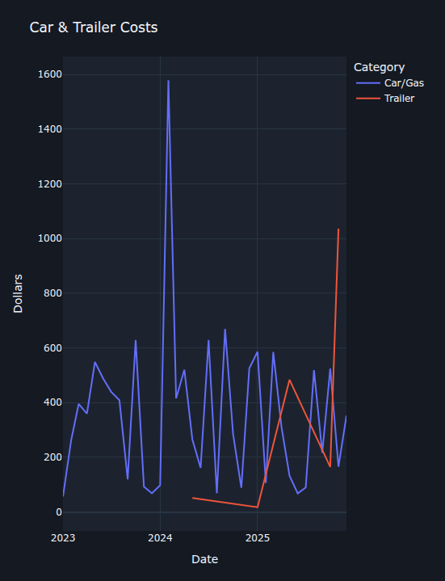

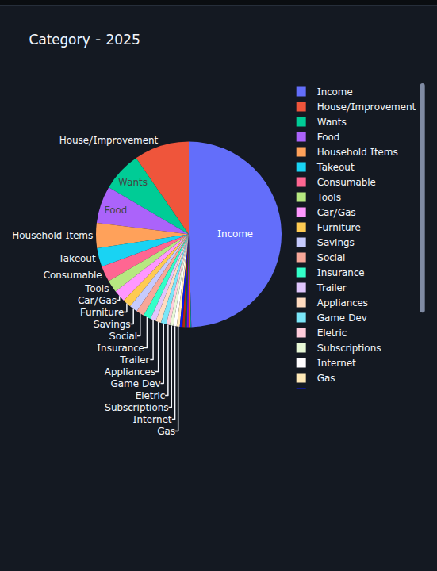

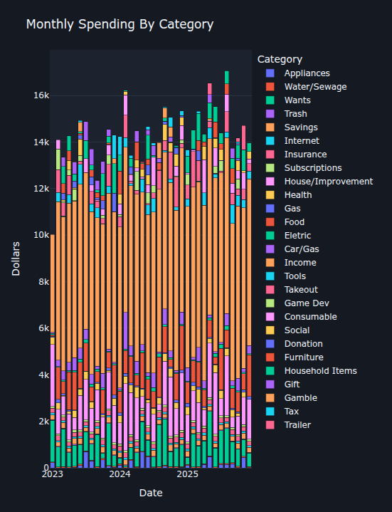

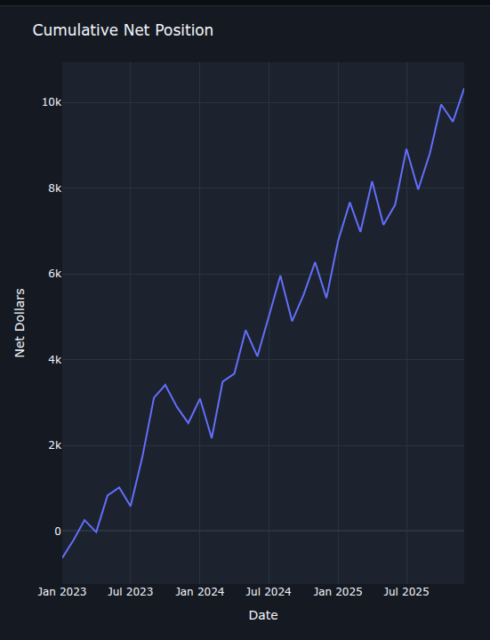

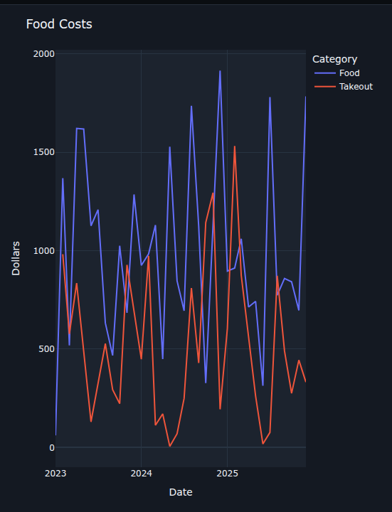

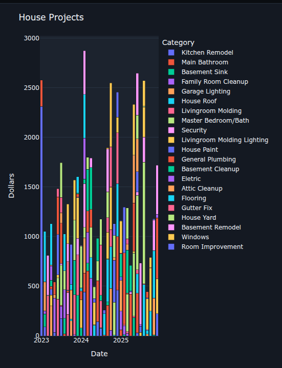

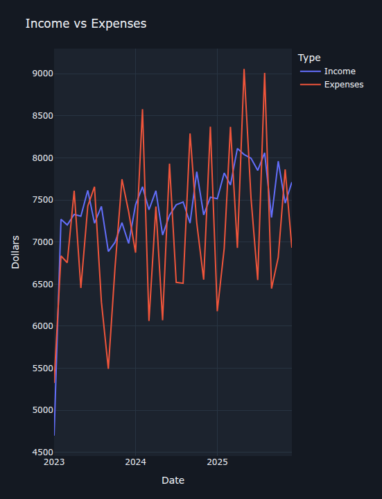

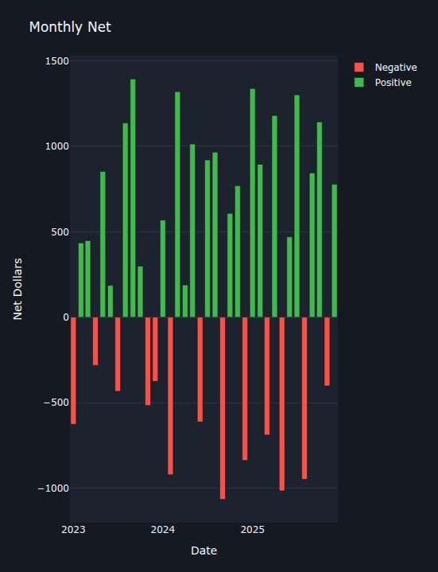

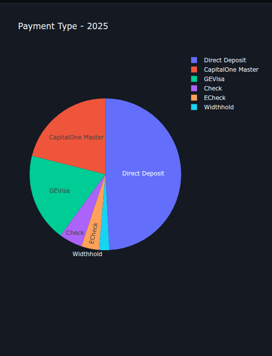

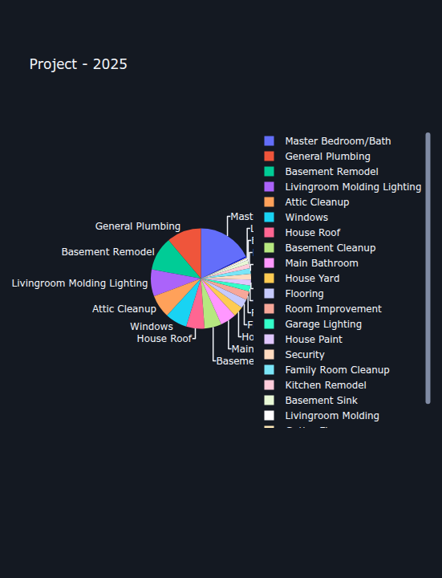

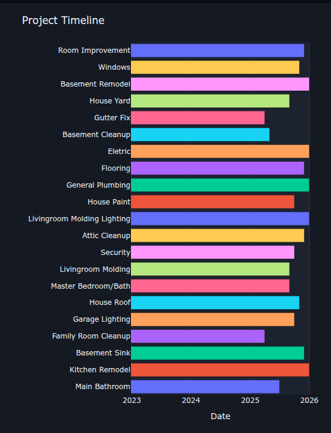

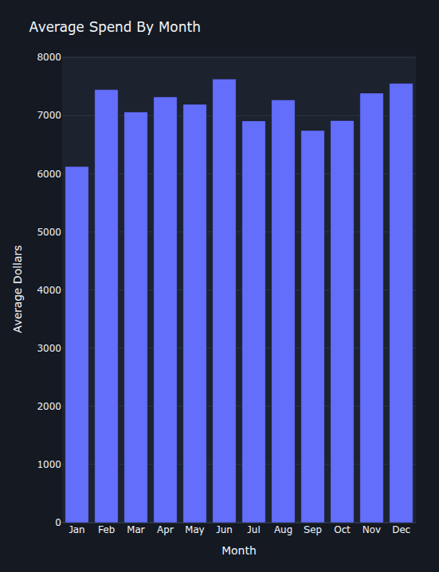

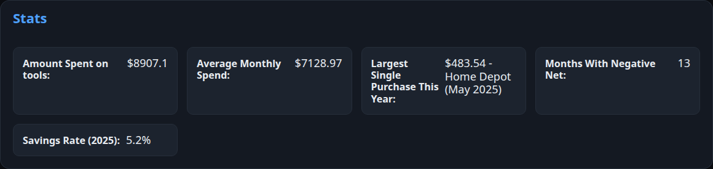

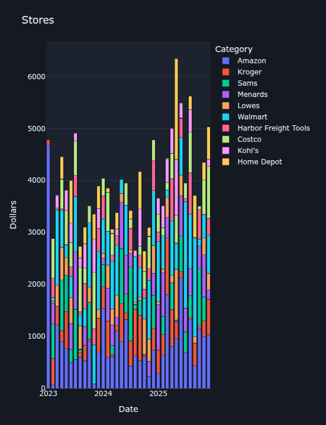

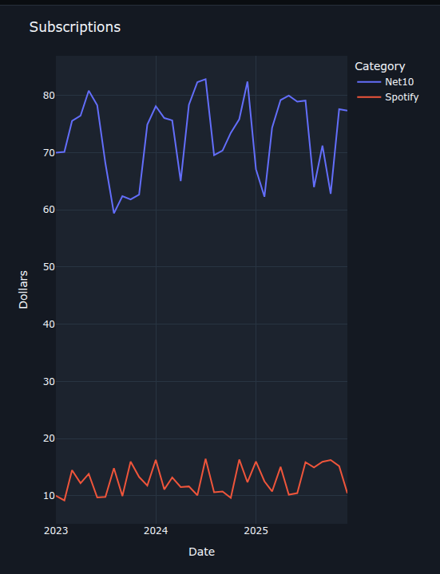

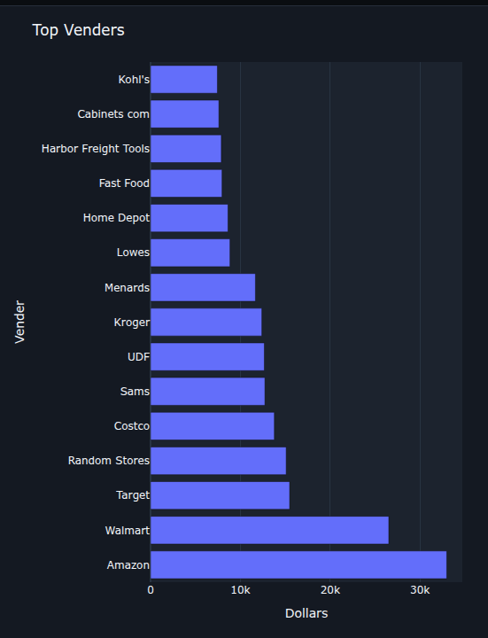

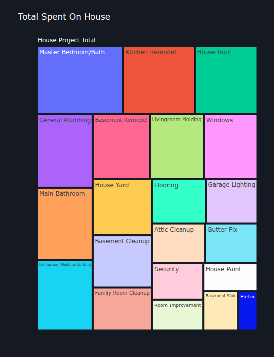

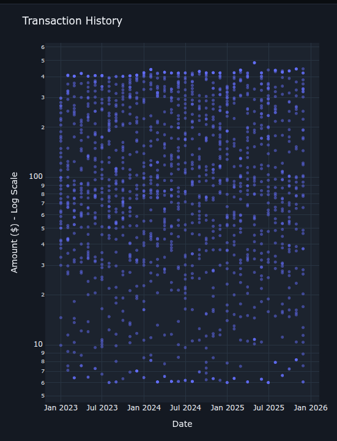

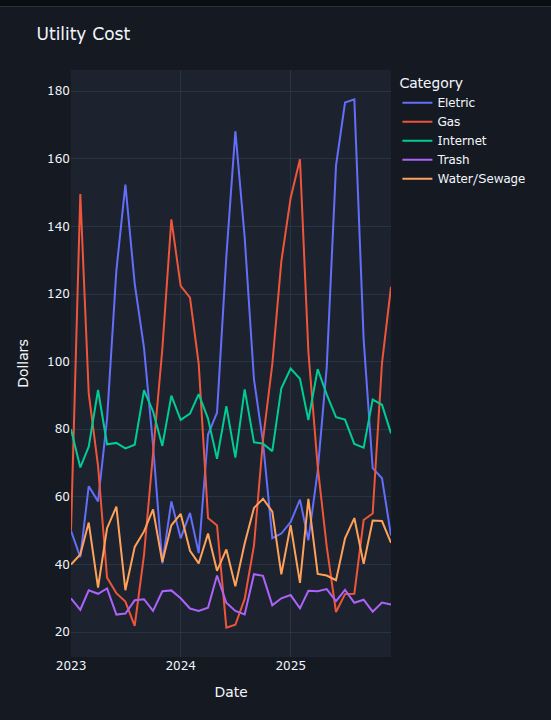

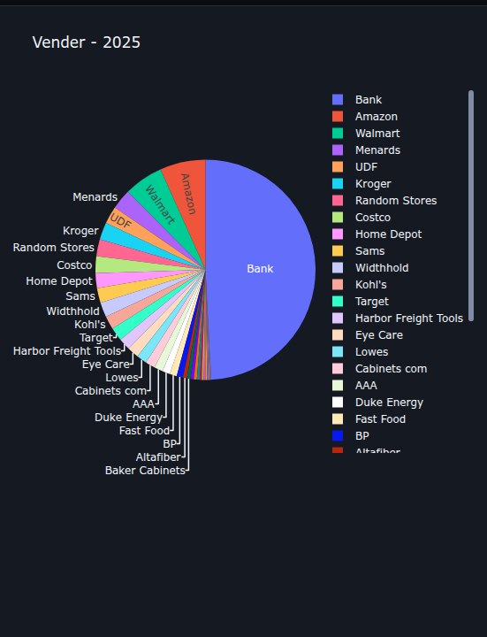

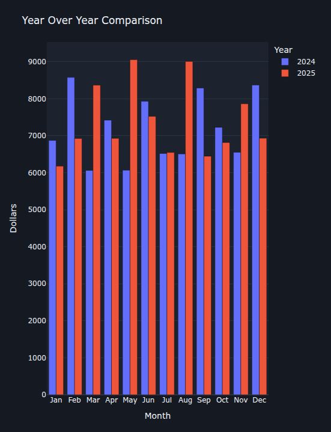
